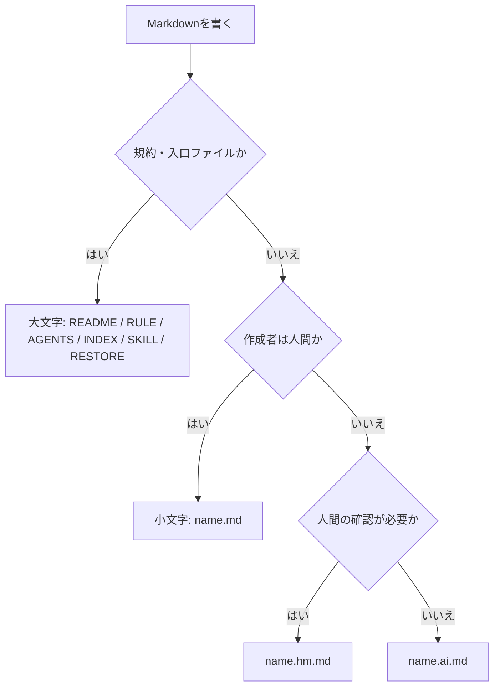

# Markdown — front matter とファイル命名

> **目的**: Markdown文書の冒頭メタデータとファイル名を統一し、人間とAIのどちらが扱う文書かを一目で判別できるようにする。
> **対象**: `doc/` 配下に作成するすべてのMarkdownと、それを生成・編集するAI。

---

## 1. 適用範囲

このルールは `doc/materials/` 配下のMarkdownに適用する。`doc/` 直下の `RULE.md` や `README.md` などの規約ファイルは、4章の例外に従う。

---

## 2. front matter

### 2.1 配置

Markdownの先頭にYAML形式のfront matterを置く。`---` はファイルの1行目から始め、前に空行やBOMを入れない。

```markdown
---
title: "プロジェクト設計書"
description: "アプリケーションの設計仕様をまとめた文書"
author: "funa"
date: 2026-11-22
version: "1.0.0"
status: draft
tags:
  - design
  - architecture
  - documentation
---
```

### 2.2 必須フィールド

| フィールド | 型 | 必須 | 内容 |
|-----------|----|------|------|
| `title` | string | 必須 | 文書タイトル。H1と一致させる |
| `description` | string | 必須 | 一文で内容を説明する。改行しない |
| `author` | string | 必須 | 作成者。AI生成の場合はモデル名 |
| `date` | date | 必須 | 作成日。`YYYY-MM-DD` 形式 |
| `version` | string | 必須 | 文書のバージョン。`"1.0.0"` のように引用符で囲む |
| `status` | enum | 必須 | `draft` / `review` / `approved` / `archived` |
| `tags` | string[] | 任意 | 検索用タグ。小文字ケバブケース |
| `source` | string | 任意 | 出典（Notion、外部資料、AIとの対話など） |

### 2.3 任意フィールド（未確定）

次のフィールドは必要になった時点で追加する。追加する場合はこの表を更新する。

| フィールド | 型 | 用途 |
|-----------|----|------|
| `updated` | date | 最終更新日 |
| `related` | string[] | 関連文書への相対パス |
| `reviewer` | string | 確認者 |

### 2.4 記述ルール

- `version` は必ず引用符で囲む。YAMLの数値解釈を避けるため
- `date` は日付のみとする。時刻が必要な場合は `updated` にISO 8601で書く
- `status` は表の4値以外を使わない
- `tags` は小文字ケバブケース。日本語タグは使わない
- `description` は一文。句点は付けても付けなくてもよいが、文書内で統一する
- 認証情報、APIキー、個人情報をfront matterに書かない
- front matterはメタデータであり、本文の代わりにしない

### 2.5 status の意味

| 値 | 意味 | 遷移先 |
|----|------|--------|
| `draft` | 作成中。内容が変わりうる | `review` |
| `review` | 人間の確認待ち | `approved` または `draft` |
| `approved` | 確定。以後の変更は版を上げる | `archived` |
| `archived` | 役目を終えた文書。参照用に残す | なし |

---

## 3. ファイル命名規則

### 3.1 3分類と大文字ファイル

| 種別 | 命名 | 作成者 | 主な読者 | 例 |
|------|------|--------|----------|-----|
| 人間確認用 | `<name>.hm.md` | AI | 人間（確認・承認） | `design.hm.md` |
| AI専用 | `<name>.ai.md` | AI | AI | `context.ai.md` |
| 人間作成 | `<name>.md` | 人間 | 人間・AI | `requirements.md` |
| 規約・入口 | `<NAME>.md`（大文字） | 人間 | 人間・AI | `README.md`、`RULE.md`、`AGENTS.md`、`INDEX.md`、`SKILL.md`、`RESTORE.md` |

- `.hm` は **Human-checked** の意味。AIが作り、人間が確認する文書
- `.ai` は **AI-only** の意味。AIが作り、AIが読む文書。人間の確認を前提にしない
- サフィックスなしの小文字は **人間が作成・維持する文書**。AIは明示指示がない限り編集しない
- 大文字ファイルは役割が固定された規約・入口。新しい大文字ファイルを増やさない

### 3.2 判定フロー



### 3.3 命名の詳細

- サフィックスは拡張子の直前に置く: `design.hm.md`、`context.ai.md`
- ベース名は小文字ASCIIのケバブケース: `api-design.hm.md`
- スペース、大文字、日本語、アンダースコアは使わない
- 1ファイル1トピック。内容が2つに分かれる場合はファイルを分ける
- 日付を含むログは `YYYY-MM-DD-<topic>.ai.md` とする
- バージョンを含むファイル名は作らない。版はfront matterの `version` で管理する

### 3.4 ディレクトリごとの既定

| ディレクトリ | 既定の種別 | サフィックス |
|-------------|-----------|-------------|
| `materials/architecture/` | AI生成・人間確認 | `.hm.md` |
| `materials/design/` | AI生成・人間確認 | `.hm.md` |
| `materials/guide/` | AI生成・人間確認 | `.hm.md` |
| `materials/implementation/` | AI生成・人間確認 | `.hm.md` |
| `materials/verification/` | AI生成・人間確認 | `.hm.md` |
| `materials/review/` | AI生成・人間確認 | `.hm.md` |
| `materials/memo/` | AI専用 | `.ai.md` |
| `materials/temp/` | AI専用 | `.ai.md` |
| `materials/prompt/` | AI専用 | `.ai.md` |
| `materials/misc/` | 内容次第 | 3.2のフローで判断 |
| 人間が書く要件・議事録 | 人間作成 | `.md` |

---

## 4. 例外

| 対象 | 扱い | 理由 |
|------|------|------|
| `SKILL.md` | エージェント仕様のfront matter（`name`、`description`、`license`、`compatibility`、`metadata`）を使う | スキルローダーが解釈するため |
| `README.md` | 大文字。front matterを付けない | GitHubやnpmで生のYAMLが見えるのを避ける |
| `RULE.md` | 大文字。front matterを付けない | 規約ファイルは本文が主 |
| `AGENTS.md` | 大文字。front matterを付けない | エージェントが全文を読むため |
| `INDEX.md` | 大文字。front matterを付けない | ナビゲーション専用 |
| `RESTORE.md` | 大文字。front matterを付けない | `ptcli` が生成・更新する復元手順 |
| `doc/rules/*-rule.md` | `*-rule.md` の命名を維持し、`.hm` / `.ai` を付けない | `rules/RULE.md` が定めるルールファイルの形式 |
| `materials/memo/memo.md` | 小文字 `.md` のまま維持する（一般メモ） | `RULE.md` 8章で定義済み。会話ログ `ai-logs/` とは別用途 |
| `.gitkeep` などの空ファイル | 対象外 | Markdownではない |

---

## 5. 移行ルール

- 新規作成するMarkdownは、このルールに従う
- 既存ファイルは一括リネームしない。編集するタイミングでリネームする
- 既存の冒頭ブロック（`> **出典**:` など）は、移行時にfront matterの `source` へ移す
- 移行が済むまで、既存の冒頭ブロックとfront matterの併記を許容する
- 移行対象の一覧が必要になったら、`ptcli` に `doc-lint` を追加して検出できるようにする（未実装）

---

## 6. フォーマットチェックリスト

### 文書（`*.hm.md` / `*.ai.md` / `*.md`）

- [ ] front matterが1行目から始まっている
- [ ] `title`、`description`、`author`、`date`、`version`、`status` が揃っている
- [ ] `version` が引用符で囲まれている
- [ ] `date` が `YYYY-MM-DD` 形式である
- [ ] `status` が4値のいずれかである
- [ ] `tags` が小文字ケバブケースである
- [ ] ファイル名が種別に合ったサフィックスを持つ
- [ ] ベース名が小文字ASCIIのケバブケースである
- [ ] H1が `title` と一致している
- [ ] 認証情報や個人情報が含まれていない

### 規約・入口ファイル（大文字）

- [ ] 役割が固定されたファイル名である
- [ ] front matterを付けていない
- [ ] 本文の冒頭で目的と対象が分かる
